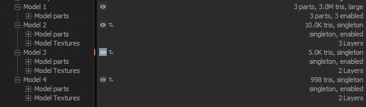
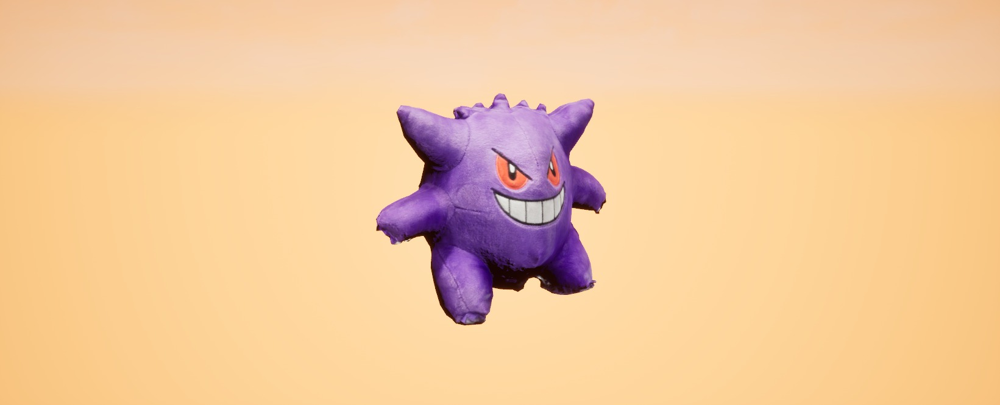

# Práctica 6: Digitalización 3D, Optimización e Integración en Realidad Mixta (UE 5.8)

## 1. Captura Fotogramétrica y Optimización (Retopología y LODs)

El objeto elegido es un peluche de **Gengar**, procesado mediante fotogrametría y optimizado para dispositivos XR manteniendo la calidad visual mediante mapas 2K y una cadena de **3 niveles de detalle (LODs)** fusionados en el asset `GengarRetopologyLOD0`.

| Nivel de Detalle | Triángulos aprox. | Uso en escena |
| :--- | :---: | :--- |
| **LOD 0** | ~10.000 tris | Inspección cercana y agarre directo con las manos virtuales |
| **LOD 1** | ~5.000 tris | Distancia media en el espacio de trabajo |
| **LOD 2** | ~998 tris | Distancia lejana / reducción de carga geométrica |

## 2. Calibración de Escala Física y Colisiones

Para garantizar la coherencia espacial en Realidad Mixta (`1 unidad de Unreal = 1 cm`), el peluche se midió con un metro, verificando que el peluche real equivale a (`22 cm`)**.

* **Dimensiones finales bakeadas (`Approx Size`):** `~28 × 19 × 22 cm` (Eje Z = `22 cm`).
* **Normalización de transformaciones:** Escala aplicada y bakeada directamente sobre la geometría mediante **Modeling Mode > XForm > Bake Transform**, dejando la escala del actor en `1.0 × 1.0 × 1.0` en todos los LODs.

## 3. Configuración de Passthrough y Entorno de Ejecución

El proyecto está configurado para arrancar directamente en el nivel **`NivelPassthrough`** (*Project Settings > Maps & Modes*), para permitir la composición de Realidad Mixta:

* **Jugador (`BP_XRPawn`):** Configurado con `Auto Possess Player = Player 0` y el componente **`OculusXRPassthroughLayer`** activo en modo *Underlay*.
* **Soporte físico en escena:** Superficie de apoyo con colisión activa a altura de mesa (`75 cm`) para sostener `BP_Gengar` y validar las físicas de agarre y caída en el simulador.

## 5. Instrucciones de Ejecución

1. Lanzar el proyecto mediante el script **`LanzarConSimulador.bat`**.
2. Una vez abierto el proyecto (cargará automáticamente `NivelPassthrough`), pulsar **VR Preview** en la barra superior de herramientas.
3. Utilizar los controles de manos virtuales del **Meta XR Simulator** para acercarse a `BP_Gengar`, agarrarlo con el gatillo o con doble click central (*Grip*), manipularlo en el espacio y soltarlo sobre la superficie.

